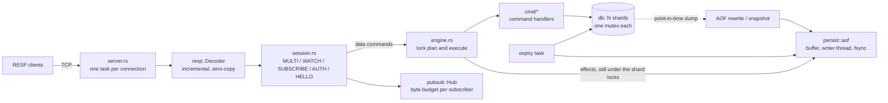

# ferrum-db

**English** | [Português (Brasil)](README.pt-BR.md)

[](https://github.com/FrancisWorld/ferrum-db/actions/workflows/ci.yml)
[](LICENSE)

An in-memory data store written in Rust on Tokio that speaks RESP2 and RESP3, so
RESP-compatible clients (`redis-cli`, client libraries) can talk to it unchanged: sharded
keyspace, five data types, TTLs, transactions, pub/sub, an append-only file with a background
rewrite, snapshots, `maxmemory` eviction and backpressure for slow subscribers.

It is a learning-grade, from-scratch implementation, not a drop-in replacement for anything.
See [Limitations](#limitations) for exactly what is missing.

## Why it exists, and what is hard about it

A key-value server looks small until you try to make its parts agree with each other:

- **Atomicity across a sharded keyspace.** Commands lock only the shards of the keys they touch,
  always in ascending shard order (no lock-order deadlocks). Multi-key commands (`MSET`,
  `LMOVE`, `SINTERSTORE`...) are atomic across shards; `EXEC` locks every shard.
- **A log that is a valid serialisation of execution.** The AOF record is appended *while the
  command still holds its shard locks*, so replay order equals execution order, and a client
  on `appendfsync always` is acknowledged only after the fsync that covers its command.
- **Time and replay.** Expiry is wall-clock based, but replaying a log later must not change
  results. Keys are logged with absolute deadlines, expirations and evictions are logged as
  `DEL`, and replay runs with a frozen clock so nothing expires mid-recovery.
- **Crashing in the middle of a write.** A torn final record (or a torn `MULTI ... EXEC` block) is
  cut off and recovery continues; anything else that fails to parse refuses to start.
- **Rewriting the log while it is being written.** A point-in-time dump plus a diff buffer lets
  `BGREWRITEAOF` run while clients keep writing, without losing or duplicating a command.
- **One slow client must not hurt the others.** Subscribers have a byte budget and are
  disconnected when they exceed it; publishers never block.

## Features

| Area | What is implemented |
|---|---|
| Protocol | RESP2 and RESP3 (`HELLO 2/3`): simple/error/integer/bulk/array, plus map, set, double, boolean, null and push frames. Inline commands (`telnet`/`nc`). Pipelining. |
| Parser | Hand-written, resumable (explicit aggregate stack, no rescans), bulk payloads split off the read buffer without copying, hard limits on lengths/depth/line size. |
| Data types | Strings, lists, hashes, sets, sorted sets (arena skip list with spans: O(log n) rank/range). |
| Keys | `DEL UNLINK EXISTS EXPIRE PEXPIRE EXPIREAT PEXPIREAT (NX/XX/GT/LT) TTL PTTL PERSIST TYPE RENAME(NX) KEYS SCAN RANDOMKEY DBSIZE FLUSHALL` |
| Expiry | Lazy on access plus an active task driven by a per-shard deadline index (exact, not sampled). |
| Transactions | `MULTI EXEC DISCARD WATCH UNWATCH`; queue-time errors abort with `EXECABORT`; per-key versions for `WATCH`. |
| Pub/sub | `SUBSCRIBE PSUBSCRIBE PUBLISH PUBSUB`, glob patterns, RESP2 restricted mode and RESP3 push frames. |
| Durability | AOF with `always` / `everysec` / `no`, group commit, background rewrite, torn-tail recovery; `SAVE`/`BGSAVE` binary snapshots with a CRC. |
| Memory | `maxmemory` with `noeviction`, `allkeys-lru`, `volatile-lru` (5-sample approximated LRU); evictions are logged. |
| Operations | `AUTH`, `HELLO ... AUTH`, `CONFIG GET/SET` (limited), `INFO`, graceful shutdown on SIGTERM/SIGINT, max clients. |

## Architecture



Source layout: `src/resp` (wire format), `src/db` (shards, values, skip list, eviction),
`src/cmd` (command table and handlers), `src/engine.rs` (execution and persistence control),
`src/session.rs` (connection-level commands), `src/persist` (AOF, rewrite, snapshot, recovery),
`src/pubsub.rs`, `src/server.rs`, `src/bin/ferrum-load.rs` (load generator).

## Quickstart

```bash
# build and run (data in ./data, AOF fsynced about once a second)
cargo build --release
./target/release/ferrum-db --port 6380 --dir ./data --aof --aof-fsync everysec

# in another terminal: any RESP client works, e.g. a locally installed redis-cli
redis-cli -p 6380 PING
```

The server binds to `127.0.0.1` by default. **It refuses to start on any non-loopback address
without a password** (`--requirepass` / `FERRUM_REQUIREPASS`); the only way around that is the
explicit `--unsafe-no-auth` (`FERRUM_ALLOW_NO_AUTH=1`), which logs a loud warning. An empty password
counts as no password.

Or with Docker (multi-stage, non-root, read-only root filesystem, data on a volume). The compose
file requires a password and publishes the port on `127.0.0.1` only; generate one per run, never
commit it:

```bash
export FERRUM_REQUIREPASS=$(openssl rand -hex 16)
docker build -t ferrum-db:local .
docker compose up -d --no-build        # `docker compose up -d --build` also works where buildx exists
docker run --rm --network ferrum-db_default redis:7-alpine redis-cli -h ferrum -p 6380 -a "$FERRUM_REQUIREPASS" PING
docker compose down -v

scripts/smoke.sh   # generates its own password, writes, SIGKILLs the container, restarts, verifies
```

All flags can also be set through `FERRUM_*` environment variables (see `ferrum-db --help` and
[`.env.example`](.env.example)).

### A real session

Output of `redis-cli` from the `redis:7-alpine` image against the compose service (recorded before a password became mandatory; today, authenticate first with `-a "$FERRUM_REQUIREPASS"` or `export REDISCLI_AUTH="$FERRUM_REQUIREPASS"`):

```text
$ redis-cli -h ferrum -p 6380 SET greeting "hello ferrum"
OK
$ redis-cli -h ferrum -p 6380 ZADD leaderboard 100 alice 250 bob 175 carol
3
$ redis-cli -h ferrum -p 6380 ZREVRANGE leaderboard 0 1 WITHSCORES
bob
250
carol
175
$ redis-cli -h ferrum -p 6380 -3 HELLO 3 | head -4
server ferrum-db
version 0.1.0
proto 3
id 12
$ printf "MULTI\nINCR hits\nINCR hits\nEXEC\n" | redis-cli -h ferrum -p 6380
OK
QUEUED
QUEUED
1
2
$ redis-cli -h ferrum -p 6380 INFO persistence | head -4
# Persistence
aof_enabled:1
aof_fsync:everysec
aof_current_size:409
```

`redis-benchmark` (from the same image) also ran its `ping set get incr lpush rpush lpop rpop sadd
hset spop zadd zpopmin lrange mset` workloads against the server and completed them all (it
only warned that it could not fetch the server `CONFIG`); that was a compatibility check, not a
performance measurement.

## Design decisions and trade-offs

**Sharded mutexes instead of a single-threaded event loop.** Throughput scales with cores on
independent keys (see the sharding benchmark below), and no handler needs to be written
re-entrantly. The price is explicit locking: every command declares a *lock plan* (which
argument positions are keys), the engine locks those shards in ascending order and the handler
runs against the locked set. `EXEC` locks *all* shards, so a transaction is atomic against every
other client but also pauses them for its duration.

**The AOF is appended under the shard locks, written by a dedicated thread.** Request tasks never
do file I/O. The writer drains whatever accumulated, writes it, and under `always` fsyncs once
for the whole batch (group commit) before waking the clients in it. If the writer ever fails, the
server refuses writes with `MISCONF` instead of acknowledging data it cannot persist.

**Rewrite without `fork`.** Rust has no cheap copy-on-write snapshot, so `BGREWRITEAOF` takes all
shard locks, clones the dataset (values are reference-counted, so this copies structure, not
payloads) and starts mirroring new commands into a diff buffer, then releases the locks. A
background thread writes the compacted file; the writer thread appends the diff and renames it
over the AOF. The stop-the-world cost is the clone: **50 ms and 114 ms in two runs with 950,331
keys** (see [Benchmarks](#benchmarks)). It is proportional to the key count, which is the main
disadvantage versus a forking design.

**Expiry is an index, not sampling.** Each shard keeps an ordered `(deadline, key)` set, so the
active task reclaims exactly the keys that are due, in order, within a per-pass budget. Every
reclaimed key is logged as `DEL`; replay then needs no clock at all.

**Approximated LRU.** `maxmemory` is checked before write commands; the engine samples 5 random
keys (from random shards), evicts the least recently used of them and repeats. Memory is an
*estimate* maintained incrementally per value (no O(n) recount): at 950k small keys it reported
321 MB against 491 MB of process RSS (1.5x), because allocator overhead and I/O buffers are not
counted. Before a write, the engine estimates its growth from the argument sizes (an upper bound for
strings, lists, hashes, sets and sorted sets), evicts until that much fits and otherwise answers
`OOM` without applying anything; `EXEC` does the same for the whole queue. A request larger than the
limit is refused without evicting. Commands whose result is bigger than their arguments
(`SUNIONSTORE`, `SINTERSTORE`, `SDIFFSTORE`) are not bounded and can still overshoot.

**Zero-copy parsing, but detached storage.** The decoder returns bulk strings as slices of the
socket buffer. Storing such a slice would keep the *whole* buffer alive for as long as one key
lives; the first version did exactly that and used 914 MB of RSS for 950k small keys. Every payload
is now copied into its own allocation at the storage boundary (491 MB), and a unit test asserts it.

**Skip list with spans instead of a balanced tree.** Rank and range-by-rank need order statistics.
The arena-backed skip list stores a span per link, so rank, `ZRANGE` by index and `ZCOUNT` are
O(log n); it is checked against a `BTreeMap` model by property tests, with structural invariants
verified after every operation.

**Slow subscribers are disconnected, not buffered forever and not allowed to block.** Each
subscriber owns an unbounded queue with a tracked byte size. When it falls more than the limit
(`--pubsub-buffer-limit`, default 8 MiB) behind, the hub flags it and the connection is closed,
even if it is blocked in a socket write. This mirrors Redis' client-output-buffer policy; the
alternative (dropping messages) would silently break ordering guarantees.

**`SCAN` iterates each shard from the end towards zero.** Removing a key moves the last slot into
the hole; scanning downward means that move can only cause a repeat, never a missed key, which
keeps the usual `SCAN` guarantee without a reverse-binary cursor.

**Authentication is a single shared password**, compared in constant time, and the server refuses
to answer `AUTH` when none is configured (instead of accepting anything).

## Testing strategy

`cargo test` runs tests; all pass (see the report below for the exact command output).

| Layer | What it proves |
|---|---|
| Unit (in `src`) | Decoder/encoder edge cases, skip-list invariants, shard TTL/watch/memory bookkeeping, pub/sub budget, AOF writer (fsync policies, group commit, rewrite swap), snapshot format and hostile input. |
| Property tests | Decoder round-trips arbitrary RESP3 frames under *arbitrary chunking*; chunking never changes the outcome; arbitrary bytes never panic or over-consume; declared lengths never drive allocation; the sorted set matches a `BTreeMap` model through random add/remove/pop/range-delete sequences. These stand in for a fuzz target (no `cargo-fuzz` is installed here, so none is shipped). |
| Integration over TCP | Every command family incl. option parsing and error paths; a wrong-type matrix (every command against every other type); RESP3 reply shapes; auth; max clients; MULTI/EXEC/WATCH including a concurrent optimistic-locking counter and isolation of multi-shard transfers; pub/sub incl. a stalled subscriber; eviction policies and accounting. |
| Concurrency | 16 clients incrementing one key, `MSET`/`MGET` atomicity across shards, opposite-direction `LMOVE` storms (deadlock check), expiry racing writers. |
| Crash recovery | The real binary is killed with SIGKILL (`always` loses nothing it acknowledged), the AOF is cut at **every byte offset** of a mixed log (plain commands plus `MULTI`/`EXEC` blocks) and the recovered state must equal the last complete unit, corrupt records are reported with their offset, rewrites run under concurrent writers with no lost increments, snapshots round-trip every type, expiry and eviction cannot resurrect data. |

Measured coverage with `llvm-cov` (region coverage, all test binaries): **96.6 % overall**, every
module under `src/` between 85.7 % and 100 % except `persist/mod.rs` (73 %, an error enum and a
directory-fsync helper). Reproduce with `scripts/coverage.sh` (needs `llvm-profdata` and `llvm-cov`; the path is set
through `LLVM_BIN`).

CI (`.github/workflows/ci.yml`) runs `fmt --check`, `clippy --all-targets -D warnings`, a release
build, the whole test suite on Linux and macOS, compiles the benchmarks, and builds the Docker
image and runs `scripts/smoke.sh` (SIGKILL recovery inside Docker).

```bash
cargo fmt --all -- --check
cargo clippy --all-targets -- -D warnings
cargo test
cargo bench --bench parser --bench store
```

## Benchmarks

Everything below was measured on an **Apple M1 laptop (8 cores, 8 GB RAM)**, release build,
loopback, load generator and server on the same machine, which was also running other jobs, so
treat the numbers as indicative: two runs differed by up to about 45 %. Ranges are the min and max of
two runs. The first run predates the change that detaches stored payloads from the read buffer.
No other server was measured, so there is no comparison with Redis.

Load generator (`ferrum-load -c 50 -n 400000`, 64-byte values, 10,000 keys):

| Workload | Persistence | Pipeline | Requests/s | Batch round-trip p50 / p99 |
|---|---|---|---|---|
| SET | none | 1 | 113k to 169k | 276 to 415 us / 628 to 980 us |
| GET | none | 1 | 110k to 182k | 264 to 433 us / 532 to 930 us |
| SET | none | 16 | 0.71M to 1.25M | 0.6 to 1.1 ms / 1.7 to 2.5 ms |
| GET | none | 16 | 1.03M to 1.67M | 0.45 to 0.74 ms / 1.0 to 1.7 ms |
| ZADD (one hot sorted set) | none | 16 | 169k to 242k | 3.1 to 4.6 ms / 8.2 to 8.9 ms |
| SET | AOF `everysec` | 1 / 16 | 107k to 117k / 322k to 473k | n/a |
| SET | AOF `always` | 1 / 16 | 6.5k to 6.9k / 96k to 103k | 7.1 to 7.9 ms / 15 to 16 ms (P=16) |

`always` is bounded by the cost of one fsync per batch (about 7 ms here; Rust's `sync_data` is a
full flush on macOS), and pipelining amortises it across the batch.

Criterion micro-benchmarks (in-process, no network; ranges over two runs):

| Benchmark | Time |
|---|---|
| `GET` hit / `SET` / `INCR` through the session | 235 to 283 ns / 440 to 617 ns / 491 to 608 ns |
| `ZRANK` in a 10k sorted set (command path) | 522 to 592 ns |
| Sorted set rank, n = 1,000 / 100,000 | 154 to 175 ns / 646 to 829 ns |
| Sorted set insert + remove, n = 100,000 | 120 to 214 ns |
| Decode 1,000 pipelined `SET` commands | 133 to 152 us (about 600 to 690 MiB/s of wire data) |
| Same workload, 4 threads, 1 shard vs 16 shards | 455 to 885 ns/op vs 156 to 391 ns/op |

AOF rewrite on 950,331 keys (64-byte values, `everysec`): AOF 302 MB before, 96 MB after, wall
time 0.53 to 0.57 s, stop-the-world pause 50 to 114 ms.

Reproduce: `cargo bench --bench parser --bench store`, and start the server then
`./target/release/ferrum-load --addr 127.0.0.1:6380 --workload mixed --pipeline 16`.

## Limitations

- Not production software and never run in production; no replication, clustering, TLS, ACL users,
  scripting, streams, bitmaps, HyperLogLog, geo, modules.
- Single database: `SELECT 0` only. No blocking commands (`BLPOP`, ...), no `SORT`, no `OBJECT`,
  `MEMORY`, `DEBUG`, `SHUTDOWN` command (use SIGTERM).
- `SAVE` blocks the calling connection while the file is written; `BGSAVE` and `BGREWRITEAOF`
  pause all writers for the duration of an O(n) dump (measured above).
- `EXEC` and a few global commands (`KEYS`, `FLUSHALL`, `RANDOMKEY`) lock every shard.
- Memory accounting is an estimate; `maxmemory` is enforced against an argument-based growth estimate, so only the `S*STORE` commands can overshoot it. Set
  operations that combine several keys copy their inputs.
- Inline commands do not support quoting. RESP3 big numbers and verbatim strings are not decoded.
- Unix is the supported platform (signals); only macOS and Linux are exercised in CI.
- `docker compose build` needs buildx; locally the image was built with `docker build` and started with
  `docker compose up --no-build`. CI uses `docker compose build`.
- There is no fuzz target, only property tests; disk-full and fsync-failure paths of the AOF writer
  are implemented (writes are refused with `MISCONF`) but not exercised by a test.

## License

MIT, see [LICENSE](LICENSE).

---

Built by [Chico Oliveira](https://github.com/FrancisWorld)
