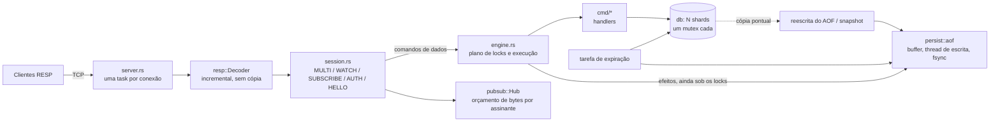

# ferrum-db

[English](README.md) | **Português (Brasil)**

[](https://github.com/FrancisWorld/ferrum-db/actions/workflows/ci.yml)
[](LICENSE)

Um banco de dados em memória escrito em Rust sobre Tokio que fala RESP2 e RESP3, de modo que
clientes compatíveis com RESP (`redis-cli`, bibliotecas cliente) conversam com ele sem
alterações: keyspace particionado em shards, cinco tipos de dados, TTL, transações, pub/sub,
arquivo append-only com reescrita em segundo plano, snapshots, remoção por `maxmemory` e
contrapressão para assinantes lentos.

É uma implementação do zero, com foco didático, e não um substituto direto de nada. Veja
[Limitações](#limitações) para saber exatamente o que falta.

## Por que existe e o que é difícil

Um servidor chave-valor parece pequeno até você tentar fazer suas partes concordarem entre si:

- **Atomicidade em um keyspace particionado.** Cada comando trava apenas os shards das chaves que
  toca, sempre em ordem crescente de shard (sem deadlock por ordem de locks). Comandos com várias
  chaves (`MSET`, `LMOVE`, `SINTERSTORE`...) são atômicos entre shards; o `EXEC` trava todos os shards.
- **Um log que é uma serialização válida da execução.** O registro do AOF é anexado *enquanto o
  comando ainda segura os locks dos shards*; assim a ordem do replay é a ordem de execução, e um
  cliente com `appendfsync always` só recebe a confirmação depois do fsync que cobre o seu comando.
- **Tempo e replay.** A expiração depende do relógio, mas reexecutar o log depois não pode mudar
  resultados. As chaves são registradas com prazos absolutos, expirações e remoções viram `DEL` no
  log, e o replay roda com o relógio congelado para que nada expire durante a recuperação.
- **Queda no meio de uma escrita.** Um último registro truncado (ou um bloco `MULTI ... EXEC`
  truncado) é cortado e a recuperação continua; qualquer outro defeito de formato impede a inicialização.
- **Reescrever o log enquanto ele é escrito.** Uma cópia pontual do dataset mais um buffer de
  diferenças permite que o `BGREWRITEAOF` rode enquanto os clientes escrevem, sem perder nem duplicar comandos.
- **Um cliente lento não pode prejudicar os outros.** Cada assinante tem um orçamento em bytes e é
  desconectado quando o excede; quem publica nunca bloqueia.

## Recursos

| Área | O que está implementado |
|---|---|
| Protocolo | RESP2 e RESP3 (`HELLO 2/3`): simple/error/integer/bulk/array, além de map, set, double, boolean, null e push. Comandos inline (`telnet`/`nc`). Pipelining. |
| Parser | Escrito à mão, retomável (pilha explícita de agregados, sem reler bytes), payloads de bulk separados do buffer de leitura sem cópia, limites rígidos de tamanho, profundidade e linha. |
| Tipos | Strings, listas, hashes, sets, sorted sets (skip list em arena com spans: rank/range em O(log n)). |
| Chaves | `DEL UNLINK EXISTS EXPIRE PEXPIRE EXPIREAT PEXPIREAT (NX/XX/GT/LT) TTL PTTL PERSIST TYPE RENAME(NX) KEYS SCAN RANDOMKEY DBSIZE FLUSHALL` |
| Expiração | Preguiçosa no acesso, mais uma tarefa ativa guiada por um índice de prazos por shard (exato, sem amostragem). |
| Transações | `MULTI EXEC DISCARD WATCH UNWATCH`; erros na fila abortam com `EXECABORT`; versões por chave para o `WATCH`. |
| Pub/sub | `SUBSCRIBE PSUBSCRIBE PUBLISH PUBSUB`, padrões glob, modo restrito do RESP2 e frames push do RESP3. |
| Durabilidade | AOF com `always` / `everysec` / `no`, group commit, reescrita em segundo plano, recuperação de cauda truncada; snapshots binários com CRC via `SAVE`/`BGSAVE`. |
| Memória | `maxmemory` com `noeviction`, `allkeys-lru`, `volatile-lru` (LRU aproximado por amostra de 5); remoções vão para o log. |
| Operação | `AUTH`, `HELLO ... AUTH`, `CONFIG GET/SET` (limitado), `INFO`, desligamento gracioso com SIGTERM/SIGINT, limite de clientes. |

## Arquitetura



Organização do código: `src/resp` (formato de rede), `src/db` (shards, valores, skip list,
remoção), `src/cmd` (tabela de comandos e handlers), `src/engine.rs` (execução e controle de
persistência), `src/session.rs` (comandos de conexão), `src/persist` (AOF, reescrita, snapshot,
recuperação), `src/pubsub.rs`, `src/server.rs`, `src/bin/ferrum-load.rs` (gerador de carga).

## Início rápido

```bash
# compilar e executar (dados em ./data, AOF com fsync cerca de uma vez por segundo)
cargo build --release
./target/release/ferrum-db --port 6380 --dir ./data --aof --aof-fsync everysec

# em outro terminal: qualquer cliente RESP serve; abaixo, o redis-cli de um contêiner
docker run --rm --network host redis:7-alpine redis-cli -p 6380 PING
```

Ou com Docker (multi-stage, usuário não root, sistema de arquivos raiz somente leitura, dados em volume):

```bash
docker build -t ferrum-db:local .
docker compose up -d --no-build        # `docker compose up -d --build` também funciona onde há buildx
scripts/smoke.sh                       # escreve, mata o contêiner com SIGKILL, reinicia e confere os dados
docker compose down -v
```

Todas as opções também podem vir de variáveis `FERRUM_*` (veja `ferrum-db --help` e
[`.env.example`](.env.example)).

### Uma sessão real

Saída do `redis-cli` da imagem `redis:7-alpine` contra o serviço do compose:

```text
$ redis-cli -h ferrum -p 6380 SET greeting "hello ferrum"
OK
$ redis-cli -h ferrum -p 6380 ZADD leaderboard 100 alice 250 bob 175 carol
3
$ redis-cli -h ferrum -p 6380 ZREVRANGE leaderboard 0 1 WITHSCORES
bob
250
carol
175
$ redis-cli -h ferrum -p 6380 -3 HELLO 3 | head -4
server ferrum-db
version 0.1.0
proto 3
id 12
$ printf "MULTI\nINCR hits\nINCR hits\nEXEC\n" | redis-cli -h ferrum -p 6380
OK
QUEUED
QUEUED
1
2
$ redis-cli -h ferrum -p 6380 INFO persistence | head -4
# Persistence
aof_enabled:1
aof_fsync:everysec
aof_current_size:409
```

O `redis-benchmark` (da mesma imagem) também executou todas as cargas `ping set get incr lpush
rpush lpop rpop sadd hset spop zadd zpopmin lrange mset` contra o servidor (apenas avisou que não
conseguiu ler o `CONFIG`); foi um teste de compatibilidade, não uma medição de desempenho.

## Decisões de projeto e trade-offs

**Mutexes por shard em vez de um laço de eventos single-thread.** A vazão escala com os núcleos em
chaves independentes (veja o benchmark de shards abaixo) e nenhum handler precisa ser reentrante.
O preço é o travamento explícito: cada comando declara um *plano de locks* (quais argumentos são
chaves), o engine trava esses shards em ordem crescente e o handler roda sobre o conjunto travado.
O `EXEC` trava *todos* os shards: a transação é atômica em relação a todos os outros clientes,
mas também os pausa enquanto dura.

**O AOF é anexado sob os locks dos shards e escrito por uma thread dedicada.** As tasks de
requisição nunca fazem I/O de arquivo. A thread escreve o que acumulou e, com `always`, faz um
fsync por lote (group commit) antes de liberar os clientes daquele lote. Se a escrita falhar, o
servidor recusa escritas com `MISCONF` em vez de confirmar dados que não consegue persistir.

**Reescrita sem `fork`.** Rust não tem snapshot copy-on-write barato; então o `BGREWRITEAOF` trava
todos os shards, clona o dataset (os valores são contados por referência: copia-se a estrutura, não
os payloads) e passa a espelhar os novos comandos em um buffer de diferenças, liberando os locks em
seguida. Uma thread em segundo plano escreve o arquivo compactado; a thread do AOF anexa as
diferenças e renomeia por cima. O custo com o mundo parado é o clone: **50 ms e 114 ms em duas
execuções com 950.331 chaves** (veja [Benchmarks](#benchmarks)). É proporcional ao número de
chaves, a principal desvantagem frente a um projeto com `fork`.

**Expiração é um índice, não amostragem.** Cada shard mantém um conjunto ordenado `(prazo, chave)`,
então a tarefa ativa recolhe exatamente as chaves vencidas, em ordem, dentro de um orçamento por
passada. Toda chave recolhida vai para o log como `DEL`; o replay não precisa de relógio.

**LRU aproximado.** O `maxmemory` é verificado antes de comandos de escrita; o engine sorteia 5
chaves (de shards aleatórios), remove a menos recentemente usada entre elas e repete. A memória é uma
*estimativa* mantida incrementalmente por valor (sem recontagem O(n)): com 950 mil chaves pequenas
ela indicou 321 MB contra 491 MB de RSS do processo (1,5x), porque a sobrecarga do alocador e os
buffers de I/O não entram na conta. A remoção ocorre antes da escrita, então o dataset pode passar
do limite em uma entrada.

**Parsing sem cópia, mas armazenamento desacoplado.** O decoder devolve bulks como fatias do buffer
do socket. Guardar uma fatia dessas manteria o buffer *inteiro* vivo enquanto uma única chave
existisse; a primeira versão fazia exatamente isso e usou 914 MB de RSS para 950 mil chaves
pequenas. Agora todo payload é copiado para sua própria alocação na fronteira do armazenamento
(491 MB), e um teste unitário garante isso.

**Skip list com spans em vez de árvore balanceada.** Rank e range por posição exigem estatísticas de
ordem. A skip list em arena guarda um span por ligação, então rank, `ZRANGE` por índice e `ZCOUNT`
são O(log n); ela é validada contra um modelo `BTreeMap` por testes de propriedade, com invariantes
estruturais verificadas após cada operação.

**Assinantes lentos são desconectados: nem buffer infinito, nem bloqueio.** Cada assinante tem uma
fila ilimitada com o tamanho em bytes contabilizado. Quando ele fica mais atrás que o limite
(`--pubsub-buffer-limit`, padrão 8 MiB), o hub o marca e a conexão é fechada, mesmo que esteja
bloqueada em uma escrita no socket. É a política de client-output-buffer do Redis; descartar
mensagens quebraria silenciosamente a garantia de ordem.

**O `SCAN` percorre cada shard do fim para o início.** Remover uma chave move o último slot para o
buraco; percorrendo para baixo, isso só pode causar repetição, nunca omissão, preservando a garantia
usual do `SCAN` sem cursor em bits invertidos.

**A autenticação é uma única senha compartilhada**, comparada em tempo constante; o servidor se
recusa a responder ao `AUTH` quando não há senha configurada (em vez de aceitar qualquer coisa).

## Estratégia de testes

O `cargo test` executa 148 testes; todos passam (veja o relatório para a saída exata).

| Camada | O que prova |
|---|---|
| Unitários (em `src`) | Casos de borda do decoder/encoder, invariantes da skip list, TTL/watch/memória dos shards, orçamento do pub/sub, escritor do AOF (políticas de fsync, group commit, troca na reescrita), formato do snapshot e entrada hostil. |
| Testes de propriedade | O decoder faz round-trip de frames RESP3 arbitrários com *qualquer fragmentação*; fragmentar nunca muda o resultado; bytes arbitrários nunca causam pânico nem consumo indevido; tamanhos declarados nunca ditam alocação; o sorted set bate com um modelo `BTreeMap` em sequências aleatórias de add/remove/pop/remoção por faixa. Fazem o papel de um alvo de fuzzing (o `cargo-fuzz` não está instalado aqui, então nenhum é distribuído). |
| Integração via TCP | Todas as famílias de comandos, incluindo opções e erros; uma matriz de tipo errado (cada comando contra cada outro tipo); formatos de resposta RESP3; auth; limite de clientes; MULTI/EXEC/WATCH com um contador otimista concorrente e isolamento de transferências entre shards; pub/sub com um assinante parado; políticas de remoção e contabilidade. |
| Concorrência | 16 clientes incrementando uma chave, atomicidade de `MSET`/`MGET` entre shards, tempestade de `LMOVE` em sentidos opostos (teste de deadlock), expiração disputando com escritores. |
| Recuperação de falhas | O binário real é morto com SIGKILL (`always` não perde nada confirmado), o AOF é cortado em **todos os offsets de byte** de um log misto (comandos simples e blocos `MULTI`/`EXEC`) e o estado recuperado deve ser o da última unidade completa, registros corrompidos são reportados com o offset, reescritas rodam com escritores concorrentes sem perder incrementos, snapshots preservam todos os tipos, expiração e remoção não ressuscitam dados. |

Cobertura medida com `llvm-cov` (cobertura de regiões, todos os binários de teste): **96,6 % no
total**, cada módulo em `src/` entre 85,7 % e 100 %, exceto `persist/mod.rs` (73 %: um enum de erro
e um auxiliar de fsync de diretório). Reproduza com `scripts/coverage.sh` (precisa de
`llvm-profdata` e `llvm-cov`; o caminho vem de `LLVM_BIN`).

O CI (`.github/workflows/ci.yml`) roda `fmt --check`, `clippy --all-targets -D warnings`, build
release, toda a suíte em Linux e macOS, compila os benchmarks, constrói a imagem Docker e executa o
`scripts/smoke.sh` (recuperação de SIGKILL dentro do Docker).

```bash
cargo fmt --all -- --check
cargo clippy --all-targets -- -D warnings
cargo test
cargo bench --bench parser --bench store
```

## Benchmarks

Tudo abaixo foi medido em um **notebook Apple M1 (8 núcleos, 8 GB de RAM)**, build release,
loopback, gerador de carga e servidor na mesma máquina, que também executava outros trabalhos;
portanto os números são indicativos: duas execuções diferiram em até cerca de 45 %. As faixas são o
mínimo e o máximo de duas execuções. A primeira execução é anterior à mudança que desacopla os
payloads armazenados do buffer de leitura. Nenhum outro servidor foi medido, então não há
comparação com o Redis.

Gerador de carga (`ferrum-load -c 50 -n 400000`, valores de 64 bytes, 10.000 chaves):

| Carga | Persistência | Pipeline | Requisições/s | Ida e volta do lote p50 / p99 |
|---|---|---|---|---|
| SET | nenhuma | 1 | 113 mil a 169 mil | 276 a 415 us / 628 a 980 us |
| GET | nenhuma | 1 | 110 mil a 182 mil | 264 a 433 us / 532 a 930 us |
| SET | nenhuma | 16 | 0,71 M a 1,25 M | 0,6 a 1,1 ms / 1,7 a 2,5 ms |
| GET | nenhuma | 16 | 1,03 M a 1,67 M | 0,45 a 0,74 ms / 1,0 a 1,7 ms |
| ZADD (um sorted set quente) | nenhuma | 16 | 169 mil a 242 mil | 3,1 a 4,6 ms / 8,2 a 8,9 ms |
| SET | AOF `everysec` | 1 / 16 | 107 mil a 117 mil / 322 mil a 473 mil | n/d |
| SET | AOF `always` | 1 / 16 | 6,5 mil a 6,9 mil / 96 mil a 103 mil | 7,1 a 7,9 ms / 15 a 16 ms (P=16) |

O `always` é limitado pelo custo de um fsync por lote (cerca de 7 ms aqui; o `sync_data` do Rust é
uma descarga completa no macOS) e o pipelining dilui esse custo no lote.

Micro-benchmarks do Criterion (em processo, sem rede; faixas de duas execuções):

| Benchmark | Tempo |
|---|---|
| `GET` acerto / `SET` / `INCR` pela sessão | 235 a 283 ns / 440 a 617 ns / 491 a 608 ns |
| `ZRANK` em um sorted set de 10 mil (caminho do comando) | 522 a 592 ns |
| Rank do sorted set, n = 1.000 / 100.000 | 154 a 175 ns / 646 a 829 ns |
| Inserir + remover no sorted set, n = 100.000 | 120 a 214 ns |
| Decodificar 1.000 comandos `SET` em pipeline | 133 a 152 us (cerca de 600 a 690 MiB/s de dados de rede) |
| Mesma carga, 4 threads, 1 shard vs 16 shards | 455 a 885 ns/op vs 156 a 391 ns/op |

Reescrita do AOF com 950.331 chaves (valores de 64 bytes, `everysec`): AOF de 302 MB antes e 96 MB
depois, tempo total de 0,53 a 0,57 s, pausa com o mundo parado de 50 a 114 ms.

Para reproduzir: `cargo bench --bench parser --bench store` e, com o servidor ligado,
`./target/release/ferrum-load --addr 127.0.0.1:6380 --workload mixed --pipeline 16`.

## Limitações

- Não é software de produção e nunca rodou em produção; sem replicação, cluster, TLS, usuários ACL,
  scripts, streams, bitmaps, HyperLogLog, geo ou módulos.
- Banco único: só `SELECT 0`. Sem comandos bloqueantes (`BLPOP`, ...), sem `SORT`, `OBJECT`,
  `MEMORY`, `DEBUG`, nem comando `SHUTDOWN` (use SIGTERM).
- O `SAVE` bloqueia a conexão que o chamou enquanto o arquivo é escrito; `BGSAVE` e `BGREWRITEAOF`
  pausam todos os escritores durante uma cópia O(n) (medida acima).
- O `EXEC` e alguns comandos globais (`KEYS`, `FLUSHALL`, `RANDOMKEY`) travam todos os shards.
- A contabilidade de memória é uma estimativa; o `maxmemory` pode ser ultrapassado em uma entrada.
  Operações entre várias chaves de sets copiam suas entradas.
- Comandos inline não aceitam aspas. Big numbers e verbatim strings do RESP3 não são decodificados.
- Unix é a plataforma suportada (sinais); apenas macOS e Linux são exercitados no CI.
- O `docker compose build` exige buildx; localmente a imagem foi construída com `docker build` e
  iniciada com `docker compose up --no-build`. O CI usa `docker compose build`.
- Não há alvo de fuzzing, apenas testes de propriedade; os caminhos de disco cheio e falha de fsync
  do escritor do AOF estão implementados (escritas recusadas com `MISCONF`), mas não são exercitados por teste.

## Licença

MIT, veja [LICENSE](LICENSE).

---

Built by [Chico Oliveira](https://github.com/FrancisWorld)
